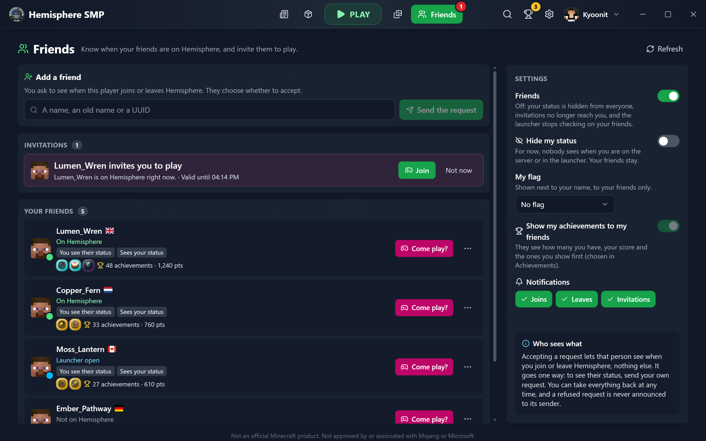

# Hemisphere Launcher

**The official launcher of Hemisphere SMP** (`play.hemispheresurvival.club`)

One click and you're on the server: Minecraft, Fabric, Java and the server's mods are installed and kept up to date for you.

<table>
  <tr>
    <td width="50%" valign="top"> <b>Achievements and badges</b> · 77 to unlock, checked by the server</td>
    <td width="50%" valign="top"> <b>Your month on Hemisphere</b> · every month since you joined</td>
  </tr>
  <tr>
    <td width="50%" valign="top"> <b>Hemisphere Wrapped</b> · your whole year, in early December</td>
    <td width="50%" valign="top"> <b>Friends</b> · who is on the server, invitations to play</td>
  </tr>
  <tr>
    <td width="50%" valign="top"> <b>Shopping District</b> · every shop and its prices, on the map</td>
    <td width="50%" valign="top"> <b>Quick search</b> · Ctrl+K to go anywhere</td>
  </tr>
  <tr>
    <td width="50%" valign="top"> <b>Mods, packs and shaders</b> · add yours from Modrinth</td>
    <td width="50%" valign="top"> <b>Your skin in 3D</b> · with your cape, and a wardrobe</td>
  </tr>
  <tr>
    <td width="50%" valign="top"> <b>News and events</b> · from the team, with reminders</td>
    <td width="50%" valign="top"> <b>Settings made for your PC</b> · memory, window, voice chat test</td>
  </tr>
</table>

**And also:** the server's live map and rules, a screenshots gallery, backups and restore points, one-click repair and help
after a crash, automatic updates, and a guided tour of every screen.

**Join us:** [Discord](https://discord.gg/m3FGGUF) · [Website](https://hemispheresurvival.club/) · [Patreon](https://www.patreon.com/HemisphereSMP)

Not an official Minecraft product. Not approved by or associated with Mojang or Microsoft.

