

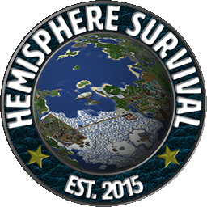

# Hemisphere Launcher

**The official launcher of Hemisphere SMP** (`play.hemispheresurvival.club`)

One click and you're on the server: Minecraft, Fabric, Java and the server's mods are installed and kept up to date for you.

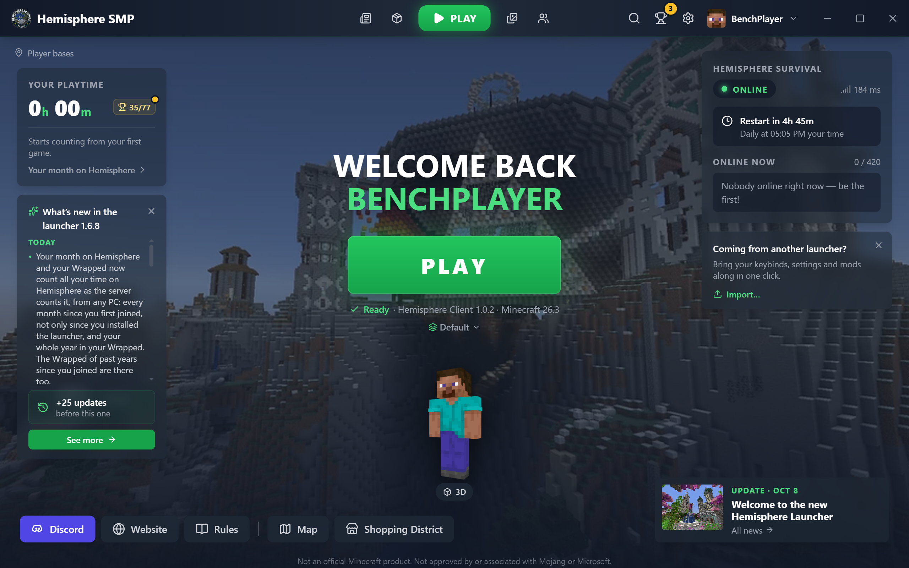

## Play in one click

**PLAY** installs (or repairs) everything Hemisphere needs and starts the game, straight onto the server if you want.
Home shows whether the server is up, who is online, when the daily restart comes, your playtime on Hemisphere (as the
server counts it, from your very first visit and on any PC) and the latest news.
If a restart takes unusually long, the launcher tells you; if the server seems down, one button lets you warn the staff on Discord.

## Quick search

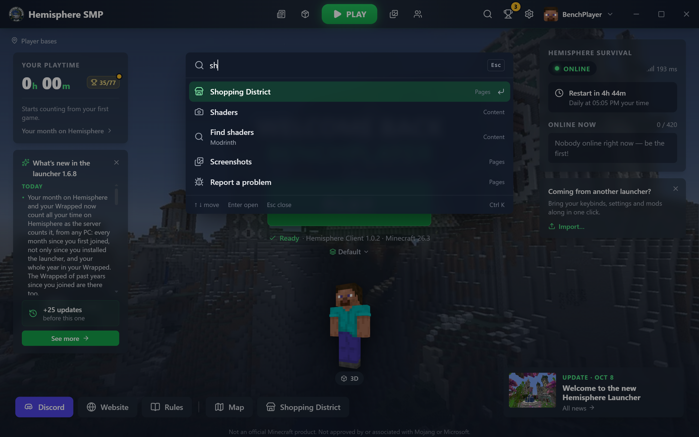

Press **Ctrl+K** (or the magnifier) and type a few letters to jump to any page, setting or content tab, or to the card of
a player online. The arrows and Enter are enough.

## Achievements and badges

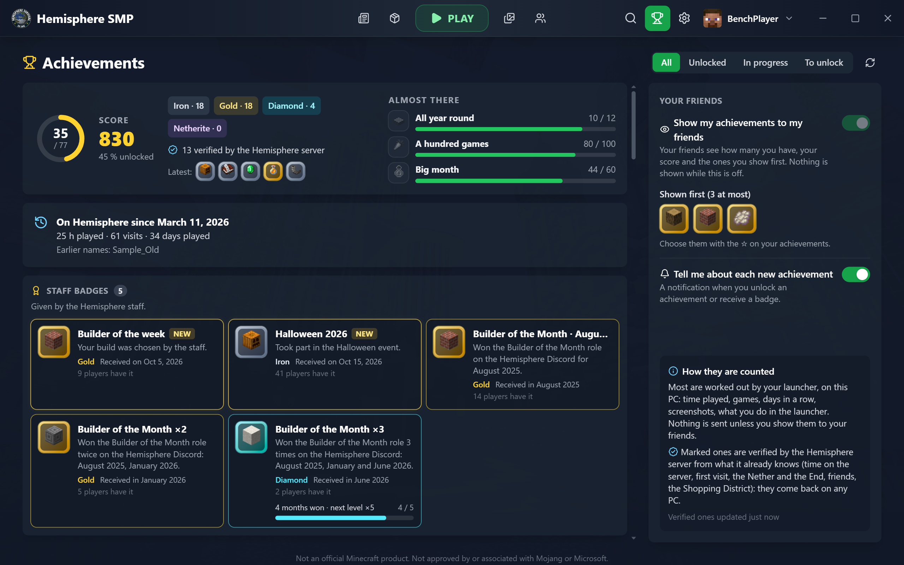

77 achievements from Iron to Netherite: hours played, visits, days in a row, events, screenshots and more. The ones the
server can check are verified, and your history on Hemisphere from before the launcher counts too, each one dated when
it really happened. The staff's badges (Builder of the Month, Camper of the Month, events…) arrive within seconds.
Show them to your friends, or keep them to yourself.

## Your month on Hemisphere and your Wrapped

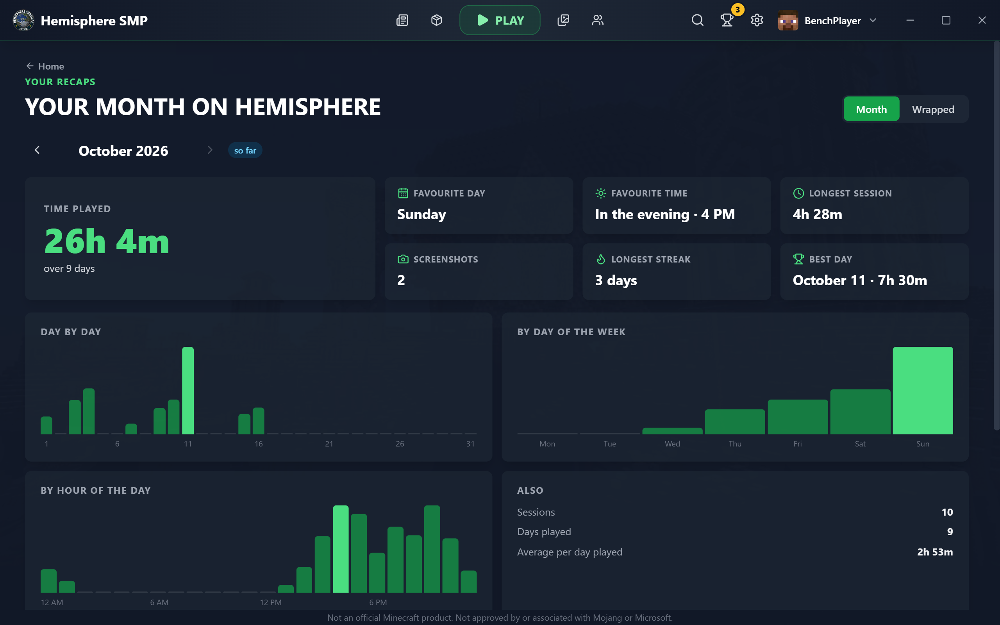

Every month since you first joined: your time played, your favourite day and time, your longest session, your best
streak, day by day and hour by hour. Around 1 December, **Hemisphere Wrapped** tells the story of your whole
year, and the past years' are always there. Save or copy the picture to share it on Discord.

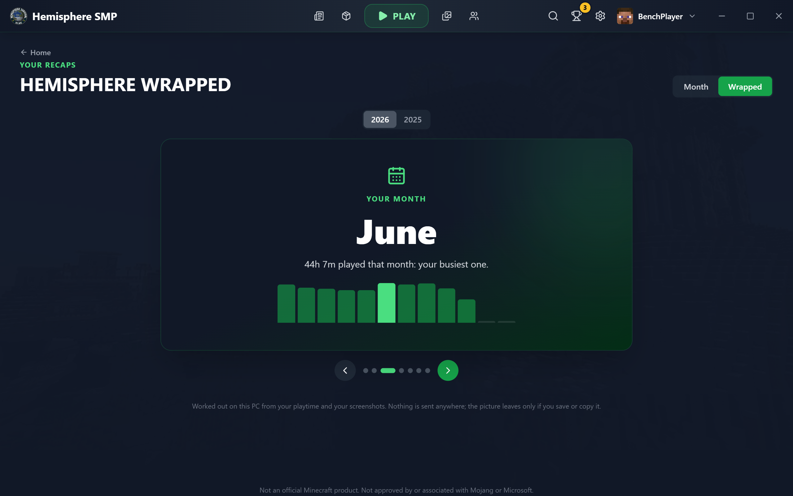

## Friends and the Shopping District

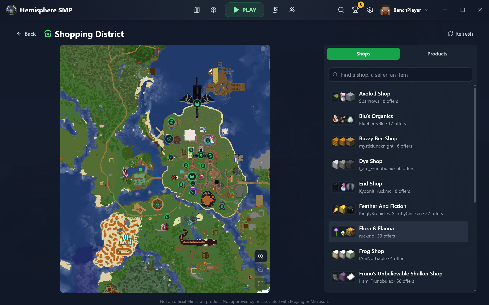

Add your friends from everyone who has played on Hemisphere, see at once who has the launcher open or is on the server,
invite them to play, and see their achievements if they share them. Or turn Friends off: nobody sees you, and your own
news still arrive at once.

The **Shopping District** puts every shop on the map with its sellers and what they sell: search an item, follow an
offer and get told when it is back in stock, or report one that is out.

## News and events

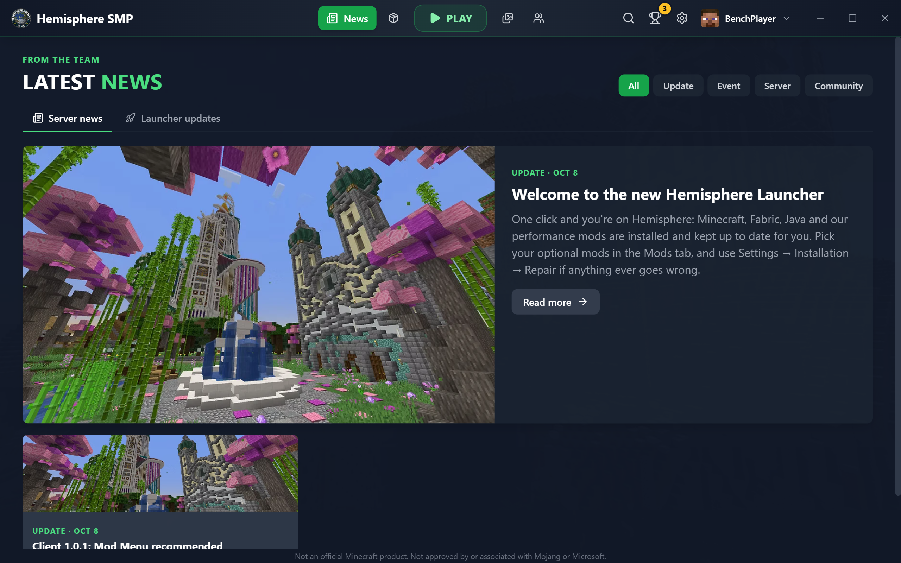

The server's news, updates and events right in the launcher, with a reminder before an event starts.
After each launcher update, "What's new" tells you what changed.

## Your mods, resource packs and shaders

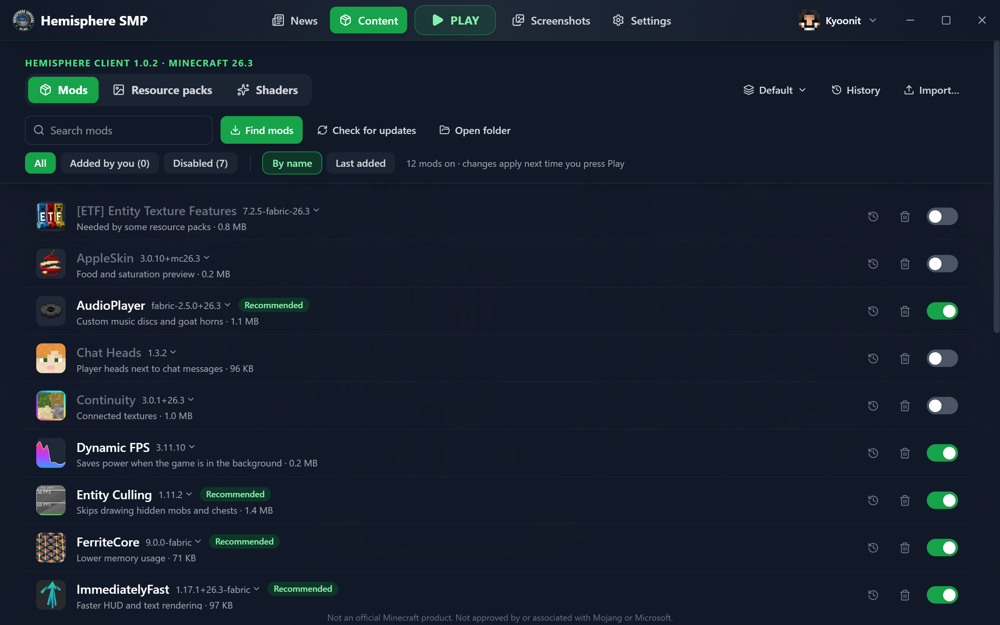

Turn the server's optional mods on or off, and add your own from Modrinth: only versions made for the server's Minecraft are offered.
Resource packs and shaders work the same way. Lock a version, go back with the history, keep several presets and switch between them.
Coming from another launcher? **Import** brings your keybinds, settings, mods and their settings along.

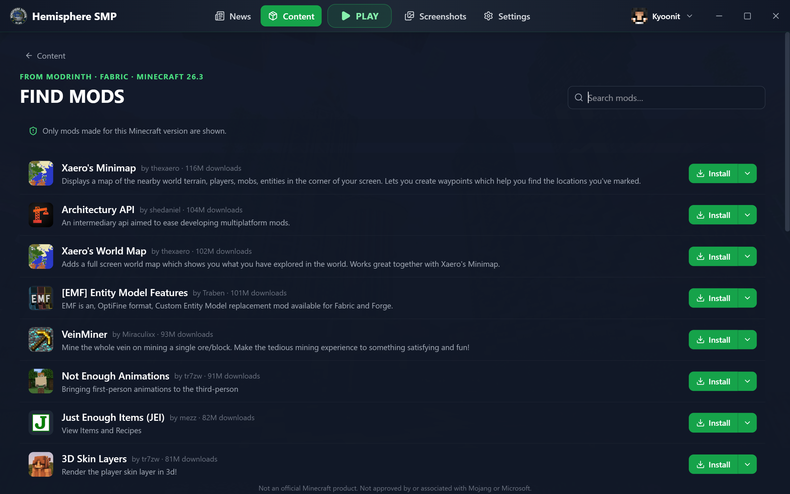

## Your skin in 3D

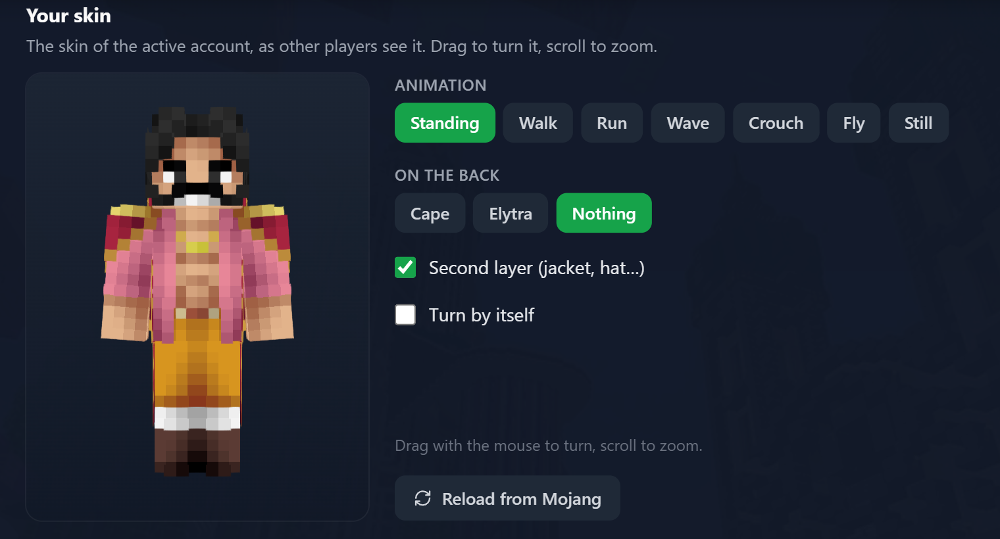

See your skin in 3D (walk, run, wave, crouch, fly…) with your cape or elytra, and try on the models and skins of the Hemisphere Patreon before you get them.

## And also

- **Map and rules:** the server's live map and its rules open right in the launcher.
- **Screenshots:** every F2 picture in a gallery, smooth even with thousands of them, ready to copy to Discord.
- **Settings made for your PC:** memory set automatically, game window size, a microphone test for voice chat, joining the server automatically.
- **Backups:** restore points of your mods and settings, and a file to bring your whole setup to another PC.
- **When something goes wrong:** a clear message, one-click repair, help after a crash, and a report to the staff that leaves out your personal details.
- **Always up to date:** the launcher updates itself in the background.
- **A guided tour** of every screen on the first start (skip it, or take it again later).

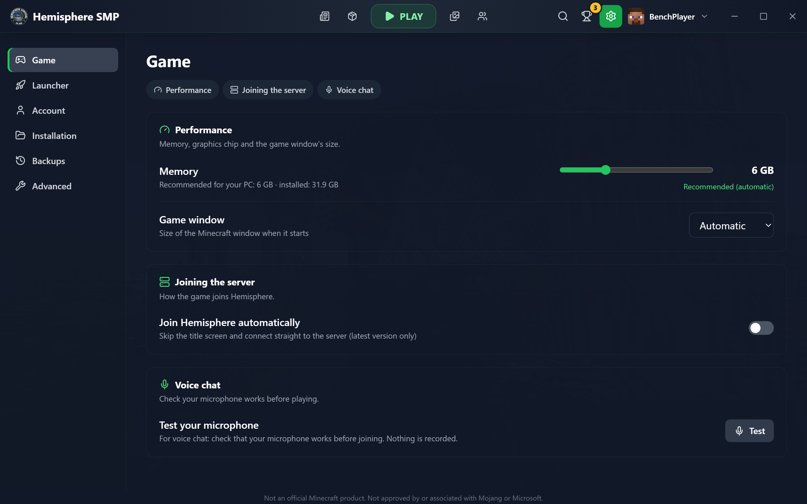

**Join us:** [Discord](https://discord.gg/m3FGGUF) · [Website](https://hemispheresurvival.club/) · [Patreon](https://www.patreon.com/HemisphereSMP)

Not an official Minecraft product. Not approved by or associated with Mojang or Microsoft.
